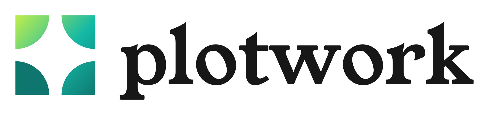
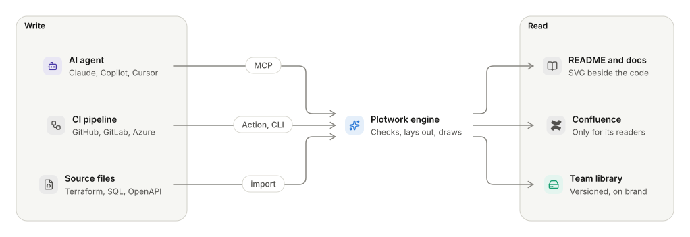

<p align="center">
  <a href="https://plotwork.dev">
    <picture>
      <source media="(prefers-color-scheme: dark)" srcset="assets/plotwork-lockup-on-dark.svg">
      
    </picture>
  </a>
</p>

<h3 align="center">Architecture diagrams that never go stale.</h3>

<p align="center">
  Your AI agent writes a few lines of text. Plotwork draws a clean, on-brand diagram<br>
  and redraws it when the code changes.
</p>

<p align="center">
  <a href="https://plotwork.dev"><b>Website</b></a> &nbsp;·&nbsp;
  <a href="https://docs.plotwork.dev/quick-start"><b>Quick start</b></a> &nbsp;·&nbsp;
  <a href="https://docs.plotwork.dev"><b>Docs</b></a> &nbsp;·&nbsp;
  <a href="https://plotwork.dev/pricing"><b>Pricing</b></a> &nbsp;·&nbsp;
  <a href="https://plotwork.dev/enterprise"><b>Enterprise</b></a>
</p>

<p align="center">
  <a href="https://www.linkedin.com/company/plotwork-dev"></a>
  <a href="https://x.com/plotwork_"></a>
  <a href="https://bsky.app/profile/plotwork.bsky.social"></a>
  <a rel="me" href="https://mastodon.social/@plotwork"></a>
  <a href="https://www.instagram.com/plotwork.official"></a>
  <a href="https://www.youtube.com/@plotwork-official"></a>
  <a href="https://www.facebook.com/people/Plotwork/61595833503686"></a>
  <a href="https://discord.gg/gcAz5RJyu"></a>
</p>

<p align="center">
  <a href="https://assets.plotwork.dev/media/films/hero/landscape-dark.mp4">
    <picture>
      <source media="(prefers-color-scheme: dark)" srcset="https://assets.plotwork.dev/media/films/hero/readme-dark.webp">
      
    </picture>
  </a>
</p>

<p align="center"><sub>Select the film to watch it in full quality.</sub></p>

<br>

## Contents

- [The problem](#the-problem)
- [What Plotwork does](#what-plotwork-does)
- [Start in a minute](#start-in-a-minute)
- [Repositories](#repositories)
- [For teams](#for-teams)

## The problem

| Problem | Today |
|---|---|
| **Diagrams drift** | A picture drawn by hand is out of date by the next release, and nobody knows which one to trust. |
| **Agents cannot draw** | AI agents write code all day but cannot use a drawing tool, so the diagram is the one part left undone. |
| **Every team draws differently** | Shapes, colours and icons change from page to page, with no review and no brand. |

## What Plotwork does

A small text language that agents write well, and an engine that draws it the same way everywhere.

<p align="center">
  <picture>
    <source media="(prefers-color-scheme: dark)" srcset="assets/how-it-works-dark.svg">
    
  </picture>
</p>

<p align="center"><sub>Drawn by Plotwork from <a href="assets/how-it-works.diagram">22 lines of text</a>.</sub></p>

| Feature | What you get |
|---|---|
| **29 kinds of diagram** | Flow, sequence, database, C4, state, Gantt, mind map, Sankey, Wardley and more. |
| **Drawn from your files** | Terraform, Bicep, CloudFormation, Pulumi, SQL, Prisma, OpenAPI, Kubernetes, Compose and more. |
| **Over 5,500 icons** | AWS, Azure, Google Cloud, Kubernetes and the brands your stack uses. |
| **Checked like code** | Every mistake comes back with a line, a column and a fix, so an agent corrects itself. |
| **Kept in sync** | CI redraws every diagram on change and fails the build when one is stale. |

## Start in a minute

<p>
  <a href="https://www.npmjs.com/package/@buun_group/plotwork-mcp"></a>
  <a href="https://www.npmjs.com/package/@buun_group/plotwork"></a>
  <a href="https://github.com/plotwork-official/plotwork-action"></a>
  <a href="https://gitlab.com/explore/catalog/plotwork/plotwork-component"></a>
  <a href="https://marketplace.visualstudio.com/items?itemName=plotwork.plotwork-diagrams"></a>
  <a href="https://registry.terraform.io/providers/plotwork-official/plotwork/latest"></a>
  <a href="https://hub.docker.com/r/plotwork/selfhost"></a>
</p>

**With an AI agent** (Claude Code shown; Cursor, VS Code and Claude Desktop work too):

```sh
claude mcp add plotwork -- npx -y @buun_group/plotwork-mcp
```

**In CI**, with the GitHub Action:

```yaml
- uses: plotwork-official/plotwork-action@v1
```

**From the command line**:

```sh
npx -y @buun_group/plotwork render architecture.diagram
```

## Repositories

| Repository | What it is |
|---|---|
| [plotwork-mcp](https://github.com/plotwork-official/plotwork-mcp) | The MCP server for agents, run locally with no account. |
| [plotwork-cli](https://github.com/plotwork-official/plotwork-cli) | The `plotwork` command: render, sync Markdown, import files, check in CI. |
| [plotwork-action](https://github.com/plotwork-official/plotwork-action) | The GitHub Action that keeps every diagram in a repository current. |
| [plotwork-component](https://github.com/plotwork-official/plotwork-component) | The GitLab CI/CD component. |
| [plotwork-azure-devops](https://github.com/plotwork-official/plotwork-azure-devops) | The Azure Pipelines extension. |
| [plotwork-claude-plugin](https://github.com/plotwork-official/plotwork-claude-plugin) | The Claude Code plugin: draws diagrams as Claude saves files. |
| [terraform-provider-plotwork](https://github.com/plotwork-official/terraform-provider-plotwork) | The Terraform and OpenTofu provider: diagrams that update on every apply. |
| [plotwork-selfhost](https://github.com/plotwork-official/plotwork-selfhost) | The engine as one container, for diagram text that must stay inside your network. |
| [plotwork-examples](https://github.com/plotwork-official/plotwork-examples) | A made-up company's repository, with every workflow wired up. |
| [terraform-plotwork-examples](https://github.com/plotwork-official/terraform-plotwork-examples) | Terraform and OpenTofu examples for the provider. |

## For teams

Plotwork for organisations adds a shared, private diagram library and the controls a security review asks for.

| Control | What it does |
|---|---|
| **Your brand** | Your colours, fonts and icon packs on every diagram. |
| **Approved patterns** | Reference architectures every team draws the same way. |
| **Sign-in and audit** | SSO, SCIM, two-step sign-in and an audit log you can stream to your SIEM. |
| **Private by default** | Diagram source is not stored unless you publish it, and the engine can run on your own servers. |

<p align="center">
  <a href="https://plotwork.dev/enterprise"><b>Talk to us about Enterprise</b></a>
</p>

<br>

<p align="center"><sub>Built by <a href="https://buungroup.com">Buun Group</a>.</sub></p>
